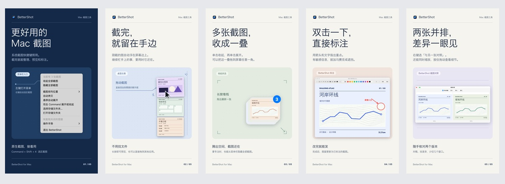

# BetterShot

**截完，就留在手边。** BetterShot 是一款 macOS 截图工具。继续用熟悉的系统截图快捷键，截完的图会浮在屏幕边上，需要时可以直接拖进聊天框、文档或访达。



## 常用操作

| 你想做什么 | 怎么操作 |
| --- | --- |
| 截图 | 按 `⌘⇧4` 截选区，按 `⌘⇧3` 截全屏。允许辅助功能访问后，也可以右键点 BetterShot 菜单栏图标启动选区截图。 |
| 预览、标注和分享 | 长按截图快速预览，双击打开标注。可以直接拖到支持图片的聊天框或应用，也可以从右键菜单隔空投送。 |
| 收起或展开 | 单击截图把它们收成一叠，再单击堆栈展开。堆栈可以拖到屏幕四角，长按后还能拖出最新一张。 |
| 看细节 | 右键复制图中文字，或选择「与另一张对照」并排查看。两张图可以同步缩放。 |
| 保存或恢复 | 用右键菜单的「关闭此图窗」保存截图，或者向截图所在的屏幕边缘滑动保存。关闭后可从菜单栏恢复最近一次关闭的图窗。 |
| 调整工作方式 | 左键点菜单栏图标，可以设置排列位置、自动拷贝、悬停自动展开、双击 Command 展开或收起，以及隐藏或显示全部截图。 |

## 从源码构建

需要 macOS 13 或更新版本，以及 Xcode 命令行工具。还没安装工具的话，先运行 `xcode-select --install`。

```sh
git clone https://github.com/mingzhijun1120-coder/BetterShot.git
cd BetterShot
./build.sh
open "$HOME/Applications/BetterShot.app"
```

初次启动时，按系统提示决定是否授予辅助功能访问。菜单栏右键截图、全局按键手势等需要该权限。若系统自己显示的截图浮动缩略图与 BetterShot 重叠，可以在 `⌘⇧5` →「选项」里关闭「显示浮动缩略图」。

## 截图存在哪里

BetterShot 运行时会把系统截图的保存位置临时切到本机工作目录，正常退出时恢复原设置。关闭时选择的保存文件夹可在菜单栏修改。仍留在屏幕边上的截图会在下次启动时恢复。截图和文字识别在本机处理；拖放、拷贝或隔空投送由你发起。

## 开源许可证

BetterShot 由 **Justin Zhou** 在 [Marco Dewey 的 ShotPin](https://github.com/DeweyMarco/shotpin) 基础上开发。项目沿用 [MIT 许可证](LICENSE)。
